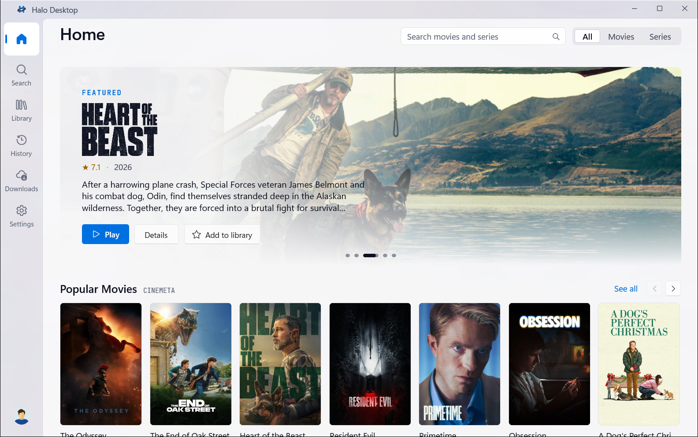
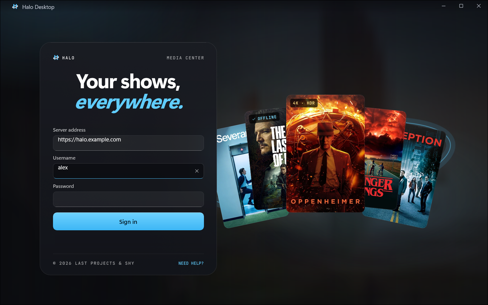
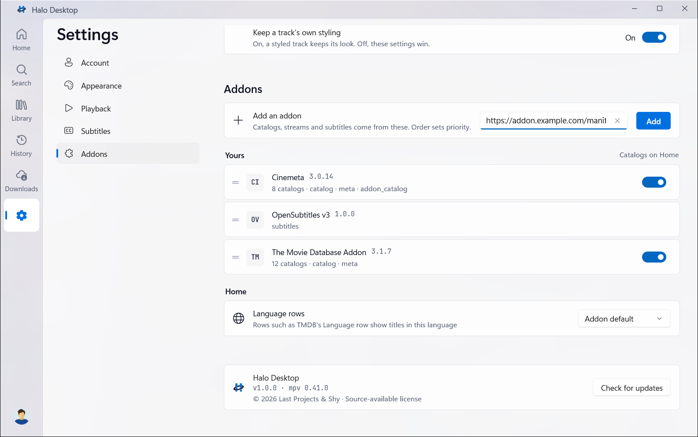
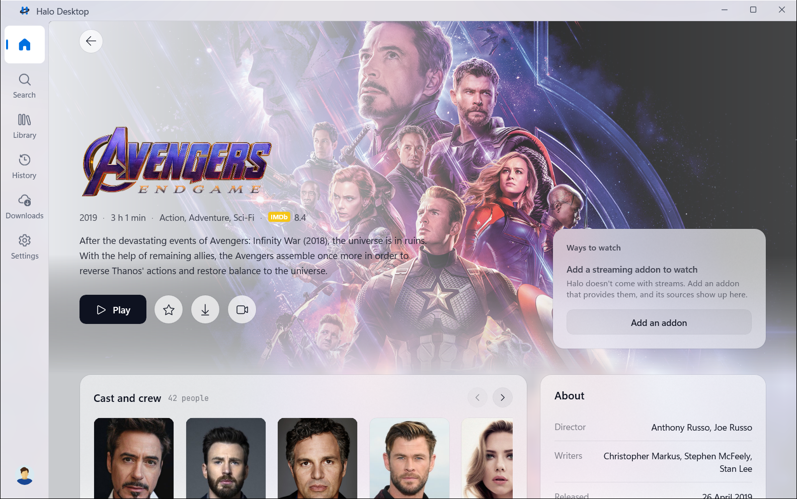

<p align="center">
  
</p>

<h1 align="center">Halo Desktop</h1>

<p align="center">
  <strong>A native Windows 11 app for Halo, the self-hosted media center.</strong>
</p>

<p align="center">
  
  
  
  
  
  
</p>

<p align="center">
  
</p>

Halo Desktop browses catalogs, plays streams, downloads for offline viewing and keeps your library and watch progress. It is built with C++/WinRT and WinUI 3, with libmpv for playback. There is no browser or web view inside.

It works in two ways:

- **With a Halo server.** Sign in and your library, progress, addons and settings sync across your devices.
- **Without an account.** Everything stays on this PC, and the app talks to your addons directly.

> [!NOTE]
> This repository is the Windows app only. The Halo server lives in [cryguy/halo](https://github.com/cryguy/halo), the project this app is based on.

## Contents

- [Install](#install)
- [Get started](#get-started)
- [Add addons](#add-addons)
- [Features](#features)
- [Player shortcuts](#player-shortcuts)
- [Privacy and local data](#privacy-and-local-data)
- [Build from source](#build-from-source)
- [License](#license)

## Install

1. Download the latest installer from the [Releases page](https://github.com/xMags/Halo-Desktop/releases). Choose the ARM64 installer for ARM devices, otherwise the standard one.
2. Run it. The installer is not signed, so Windows SmartScreen may warn you: choose **More info**, then **Run anyway**.
3. Open **Halo Desktop** from the Start menu.

Requires Windows 11. Updates are installed the same way, and your data is kept.

## Get started

<p align="center">
  
</p>

**If you have a Halo server:** choose **Use username & password**, enter the server address (for example `https://halo.example.com`), your username and your password, then **Sign in**. Servers that offer browser sign-in show that option as well.

**If you do not:** choose **Continue without an account**. You can sign in later from **Settings > Account**, and the library, progress, addons and downloads on this PC move into your account.

## Add addons

Halo gets its catalogs, streams and subtitles from addons, which use the Stremio addon protocol. Three are included so the app is useful right away:

| Addon | Provides |
| --- | --- |
| Cinemeta | Catalogs and title details |
| OpenSubtitles v3 | Subtitles |
| The Movie Database Addon | More catalogs and cast pictures |

**Halo does not include any streams.** To watch something, add an addon that provides them.

<p align="center">
  
</p>

1. Open **Settings > Addons**.
2. Paste the addon's manifest address, which ends in `/manifest.json`, for example `https://addon.example.com/manifest.json`.
3. Select **Add**.

Then, for each addon:

- **Order** sets priority. Drag a row, or use **Move up** and **Move down**.
- **Catalogs on Home** switches an addon's rows on Home on or off.
- **Remove** takes it off your list.

Home shows up to 16 catalog rows, filled in addon order. If an addon's rows are missing from Home, move it higher or switch off **Catalogs on Home** for another addon. This limit will be raised if there is demand for it.

When you are signed in, addons your server provides are listed under **For everyone**. If the server already provides an addon you also have, your copy is greyed out and the server's is used. Server administrators can install an addon for every user from the same page.

> [!TIP]
> Without an account, add a free TMDB key under **Settings > Account** to search for actors, directors and writers, and to open their pages.

## Features

<p align="center">
  
</p>

| Area | What you get |
| --- | --- |
| Home | Featured titles, a row per catalog, Continue watching and Recently watched |
| Search | Movies, series and people in one place, with suggestions and recent searches. Paste a magnet link, an IMDb link or a video link to open it |
| Library and History | Your saved titles, and everything you have watched, with resume |
| Title pages | Details, seasons and episodes, cast, trailer and similar titles |
| Sources | Every stream your addons find, ranked by quality, with filters |
| Player | Audio and subtitle tracks, speed, picture fill, seek previews, resume and next episode |
| Subtitles | Built-in and addon subtitles, with styling, delay and language preferences |
| Downloads | Fast, resumable downloads kept on this PC and playable offline, with subtitles |
| Settings | Light, dark and translucent themes, playback preferences and Discord Rich Presence |

## Player shortcuts

| Key | Action |
| --- | --- |
| `Space` | Play or pause |
| `Left` / `Right` | Seek back or forward 10 seconds |
| `Up` / `Down` | Volume up or down |
| `F` | Fullscreen |
| `Escape` | Leave fullscreen, then close the player |

## Privacy and local data

- App data is stored in `%LOCALAPPDATA%\Halo Desktop`. Installing and updating never touch it, and uninstalling keeps it unless you choose otherwise.
- Sign-in details, addon addresses added without an account, and download links are encrypted with Windows data protection (DPAPI).
- Downloads belong to the account that made them and are hidden after sign-out.
- Discord Rich Presence is optional. It shares the title you are watching and, when one is publicly available, its poster. It never shares stream links, account details or addon information.

## Build from source

You need Windows 11, Visual Studio 2026 with the **Desktop development with C++** and **C++/WinRT** components, and PowerShell 7.

Create your local server configuration. The file is ignored by Git, so your server address stays out of commits:

```powershell
Copy-Item `
  ".\src\HaloDesktop\Config\ServerConfig.example.h" `
  ".\src\HaloDesktop\Config\ServerConfig.local.h"
```

Set `ServerBaseUrl` in that file to your server's address, without a trailing slash. The example points at the local test server, `http://127.0.0.1:18790`.

Then restore, build and run from the repository root:

```powershell
$vswhere = "${env:ProgramFiles(x86)}\Microsoft Visual Studio\Installer\vswhere.exe"
$msbuild = & $vswhere -latest -products * `
  -requires Microsoft.Component.MSBuild `
  -find "MSBuild\**\Bin\MSBuild.exe" | Select-Object -First 1

& $msbuild "Halo-Desktop.slnx" -t:Restore -p:RestorePackagesConfig=true `
  -p:Configuration=Debug -p:Platform=x64

& ".\tools\fetch-mpv.ps1"
& ".\tools\Build-VulkanLoader.ps1"

& $msbuild "Halo-Desktop.slnx" -p:Configuration=Debug -p:Platform=x64 -m -v:m

& ".\x64\Debug\HaloDesktop\HaloDesktop.exe"
```

The two `tools` scripts download a pinned, checksum-verified libmpv build and build the Vulkan loader it needs. Both are safe to run again. Pass `-Platform ARM64` to either one, and to the build, for ARM devices.

**Installer.** With Inno Setup 6 installed:

```powershell
& ".\tools\Build-Installer.ps1" -Version 1.1.0
& ".\tools\Build-Installer.ps1" -Version 1.1.0 -Platform ARM64
```

The script builds Release, verifies every binary and dependency, and writes the installer to `installer\Output`.

**Test server.** The [Halo repository](https://github.com/cryguy/halo) includes a test server with sample data that resets on restart. Run it from a checkout of that repository:

```powershell
corepack pnpm --filter @halo/api dev:fixtures
```

Sign in with username `admin` and password `fixture-pass`. Add `--media "C:\path\to\video.mkv"` to test playback and downloads with a real file.

## License

Halo Desktop is **source available, not open source**, under the [Last Projects License 1.0](LICENSE).

Personal, noncommercial study, building, running and modification are permitted, subject to the full license. Organizational or commercial use, binary redistribution and AI use need separate permission. The license text is authoritative.

Installed builds are also covered by the [End-User Terms](licenses/TERMS.txt). Third-party components keep their own licenses, listed in [licenses/](licenses/THIRD-PARTY-NOTICES.txt).

For permissions, contact `info@lastprojects.com`. Bug reports with clear steps to reproduce are welcome. Code contributions need a Contributor License Agreement first, as the license requires.

## Credits

- [cryguy/halo](https://github.com/cryguy/halo) for the original Halo project and its server.
- [Stremio](https://www.stremio.com/) for the addon protocol and its ecosystem.
- [mpv](https://mpv.io/) for playback.
- Microsoft for C++/WinRT, WinUI 3 and the Windows App SDK.
- This product uses the TMDB API but is not endorsed or certified by TMDB.
